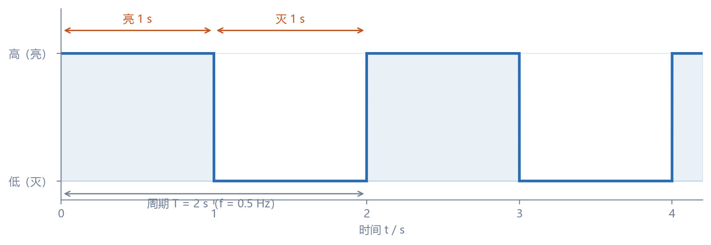
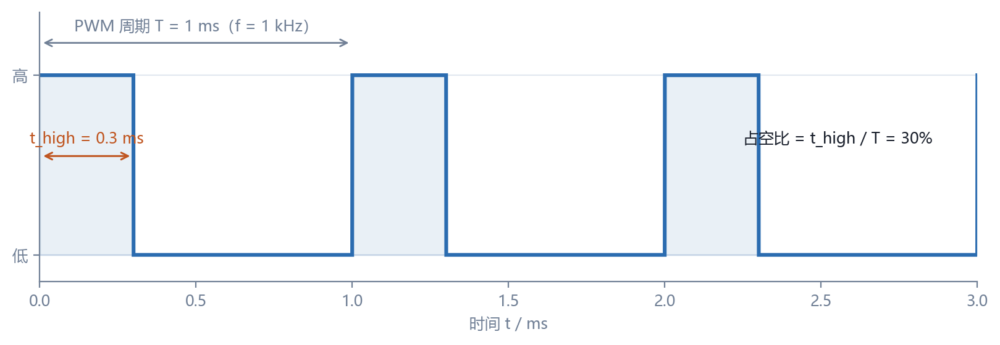
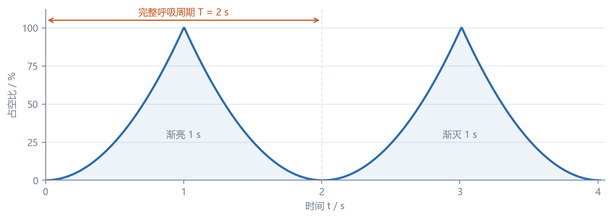

# STM32 定时器与 PWM 实验报告

| 项目 | 内容 |
| --- | --- |
| 课程 | 嵌入式基础 |
| 实验名称 | STM32 定时器计数与 PWM 呼吸灯 |
| 姓名 | 范博文 |
| 学号 | 632407030324 |
| 班级 | 2班 |
| 实验日期 | 2026-10-20 |
| 开发板 | STM32F103C8T6（Blue Pill 最小系统板） |
| 开发环境 | Keil MDK 5.40（ARMCLANG V6.22）+ STM32F10x 标准外设库 V3.5.0 |

---

## 目录

- 一、实验目的
- 二、实验原理
- 三、实验环境与器材
- 四、实验内容一：定时器计数控制 LED 以 2s 周期亮灭
- 五、实验内容二：PWM 呼吸灯
- 六、Keil 软件仿真与虚拟示波器观察
- 七、常见问题与解决
- 八、总结
- 附录 A：工程结构与编译结果
- 附录 B：提交清单
- 参考资料

---

## 一、实验目的

1. 了解 STM32F103 定时器的分类、内部结构与工作原理，理解时基单元中 **预分频器 PSC、计数器 CNT、自动重装寄存器 ARR** 的作用。
2. 掌握定时器定时时间的计算方法，能够根据目标周期反算出 PSC 与 ARR。
3. 掌握定时器 **更新中断** 的配置流程：使能时钟 → 配置时基 → 使能中断 → 配置 NVIC → 启动定时器 → 编写中断服务函数。
4. 理解 **PWM（脉冲宽度调制）** 的基本原理，掌握 PWM 模式 1/模式 2、比较寄存器 CCR、占空比与频率的计算关系。
5. 掌握定时器通道与 GPIO 引脚的复用关系，能够把 PWM 信号从指定引脚输出。
6. 使用 **Keil 软件仿真 + Logic Analyzer（逻辑分析仪，即虚拟示波器）** 观察并测量输出波形，验证定时与占空比设计是否正确。
7. 完成两个实验内容：定时器计数方式让 LED 以 2s 周期亮灭；PWM 方式实现 1~2s 周期的呼吸灯。

---

## 二、实验原理

### 2.1 STM32F103 的定时器资源

STM32F103 系列内部集成了多个 16 位定时器，按功能分为三类：

| 类型 | 定时器 | 主要功能 | 总线 |
| --- | --- | --- | --- |
| 高级定时器 | TIM1、TIM8 | 4 个独立通道 + 3 对互补通道、死区控制、刹车输入、编码器接口，常用于电机控制 | APB2 |
| 通用定时器 | TIM2、TIM3、TIM4、TIM5 | 4 个独立通道，支持输入捕获、输出比较、PWM、编码器、单脉冲 | APB1 |
| 基本定时器 | TIM6、TIM7 | 仅定时与 DAC 触发，没有外部输出引脚 | APB1 |

> **注意**：STM32F103C8T6 属于 **中容量（Medium-density）** 产品，只有 TIM1（高级）、TIM2/TIM3/TIM4（通用）和 TIM6/TIM7（基本），**没有 TIM5**（TIM5 只存在于大容量型号）。因此本实验从 TIM2~TIM4 中选择 **TIM3**。

本实验使用 TIM3 的 **通道 2（TIM3_CH2）**，其默认复用引脚为 **PA7**，与 Blue Pill 的排针直接相连，接线方便。

### 2.2 时基单元与定时时间计算

定时器的核心是一个 16 位向上/向下计数器，结构可简化为：

```
TIMx_CLK ──> [预分频器 PSC] ──> 计数脉冲 CK_CNT ──> [计数器 CNT] ──> 溢出/下溢 ──> 更新事件 UE
                                                      ↑
                                               [自动重装寄存器 ARR]
```

- **预分频器 PSC**：把定时器输入时钟 `TIMx_CLK` 分频，得到计数器实际计数频率：

  `f_CK_CNT = f_TIMx_CLK / (PSC + 1)`

- **计数器 CNT**：每个 `CK_CNT` 脉冲加 1（或减 1），从 0 计到 ARR 后溢出，产生 **更新事件（Update Event）**，然后自动重装为 0 继续计数。
- **自动重装寄存器 ARR**：决定计数上限，因此一个完整计数周期的长度为：

  `T_update = (ARR + 1) / f_CK_CNT = (PSC + 1)(ARR + 1) / f_TIMx_CLK`

  对应的更新频率为：

  `f_update = f_TIMx_CLK / ((PSC + 1)(ARR + 1))`

**时钟说明**：STM32F103 主频 72MHz 时，AHB=72MHz，APB2=72MHz，APB1=36MHz。当 APB 预分频系数不为 1 时，挂在 APB1 上的定时器时钟会 **×2**，所以 TIM2~TIM7 的时钟为 **72MHz**；TIM1/TIM8 挂在 APB2 上，时钟同样为 72MHz。

### 2.3 定时器更新中断

定时器溢出时会把状态寄存器中的 **UIF（Update Interrupt Flag）** 置 1。若使能了更新中断（`TIM_IT_Update`），并且 NVIC 中对应通道（TIM3_IRQn）已使能，CPU 就会跳转到 `TIM3_IRQHandler()` 执行中断服务函数。

完整配置流程：

1. 使能定时器时钟：`RCC_APB1PeriphClockCmd(RCC_APB1Periph_TIM3, ENABLE)`。
2. 配置时基：`TIM_TimeBaseInit()` 写入 PSC、ARR、计数模式。
3. 清除更新标志并使能更新中断：`TIM_ClearFlag()`、`TIM_ITConfig(TIM3, TIM_IT_Update, ENABLE)`。
4. 配置 NVIC：设置中断通道、抢占优先级、子优先级并使能。
5. 启动定时器：`TIM_Cmd(TIM3, ENABLE)`。
6. 在 `TIM3_IRQHandler()` 中判断并清除中断标志，执行用户逻辑。

> **要点**：中断服务函数中必须调用 `TIM_ClearITPendingBit()` 清除挂起位，否则退出中断后会立刻再次进入，程序看起来像“卡死”。

### 2.4 PWM 输出原理

PWM（Pulse Width Modulation，脉冲宽度调制）是用 **固定频率、可变高电平时间** 的方波来等效模拟量。以 PWM 模式 1 为例：

- 计数器 CNT 从 0 递增到 ARR，循环往复；
- 当 `CNT < CCR` 时，通道输出 **有效电平**（极性设为 High 时为高电平）；
- 当 `CNT ≥ CCR` 时，输出 **无效电平**（低电平）。

因此：

```text
f_PWM = f_TIMx_CLK / ((PSC + 1)(ARR + 1))
D     = CCR / (ARR + 1) × 100%
```

其中 `D` 为占空比。CCR 越大，高电平时间越长，LED 越亮。

**PWM 模式 1 与模式 2 的区别**：

| 模式 | CNT < CCR | CNT ≥ CCR |
| --- | --- | --- |
| PWM 模式 1 | 有效电平 | 无效电平 |
| PWM 模式 2 | 无效电平 | 有效电平 |

本实验使用 **PWM 模式 1 + 高电平有效**，即“高电平点亮 LED”，占空比直接对应亮度。

**分辨率**：占空比的最小步进为 `1/(ARR+1)`。本实验 ARR=999，分辨率为 0.1%，共有 1000 级可调，足够做出平滑的呼吸效果。

### 2.5 定时器通道与 GPIO 复用

定时器通道并不独占引脚，而是与 GPIO 复用。使用时必须把对应 GPIO 配置为 **复用推挽输出（AF_PP）**，否则定时器信号无法到达引脚。STM32F103C8T6 常用映射如下（默认映射，无重映射）：

| 定时器 | CH1 | CH2 | CH3 | CH4 |
| --- | --- | --- | --- | --- |
| TIM2 | PA0 | PA1 | PA2 | PA3 |
| TIM3 | PA6 | **PA7（本实验）** | PB0 | PB1 |
| TIM4 | PB6 | PB7 | PB8 | PB9 |

> TIM3 还支持部分重映射（CH1/CH2→PB4/PB5）和完全重映射（CH1~CH4→PC6~PC9），本实验使用默认映射，不需要开启 AFIO 重映射。

选择 **PA7 / TIM3_CH2** 的原因：PA7 在 Blue Pill 两侧排针均有引出，接线方便；TIM3 是通用定时器，资料多、配置简单；PA7 不属于调试引脚（JTAG/SWD），不会与下载器冲突。

### 2.6 呼吸灯与亮度校正

“呼吸灯”是指 LED 亮度按“渐亮 → 渐灭 → 渐亮”平滑循环变化。实现方法是让 PWM 占空比按三角波或正弦规律变化。

人眼对亮度的感知并不是线性的：在低亮度区，较小的占空比变化就能被明显察觉；在高亮度区，需要较大的变化才感觉得到。若占空比随时间 **线性** 增加，看起来会“低亮度段变化太快、高亮度段变化太慢”，呼吸效果生硬。

显示领域通常用 **gamma 校正** 描述这种非线性关系，近似为：

```text
L_perceived ≈ D^(1/γ),   γ ≈ 2.2
```

为了让“感知亮度”随时间近似线性变化，应让占空比按 `t^γ` 变化。本实验取 `γ≈2`（平方近似），即：

```text
D(k) = (k / N)^2 × 100%,   N = 200
```

其中 `k=0,1,2,…,200` 为亮度等级。这样低亮度区占空比增长慢、高亮度区增长快，眼睛看到的亮度变化更均匀，呼吸效果更自然。

---

## 三、实验环境与器材

### 3.1 硬件器材

| 名称 | 数量 | 说明 |
| --- | --- | --- |
| STM32F103C8T6 最小系统板（Blue Pill） | 1 | 板载 8MHz 晶振、PC13 LED、Micro-USB 接口 |
| LED（红/绿/蓝均可） | 1 | 本实验用 1 只 |
| 限流电阻 220Ω | 1 | 限制 LED 电流 |
| 面包板 + 杜邦线 | 若干 | 搭建电路 |
| ST-Link V2 下载器 | 1 | SWD 下载与调试 |
| PC（Windows 11） | 1 | 运行 Keil MDK |

### 3.2 软件环境

| 软件 | 版本/说明 |
| --- | --- |
| Keil MDK-ARM | 5.40，编译器 ARMCLANG V6.22 |
| STM32F1xx Device Family Pack | Keil.STM32F1xx_DFP 2.4.1 |
| STM32F10x 标准外设库（SPL） | V3.5.0 |
| CMSIS Core | V6.1.0（随工程附带） |
| 串口/下载工具 | ST-Link 驱动、STM32 ST-LINK Utility（可选） |

本实验的两个工程均为 **自包含工程**：启动文件、CMSIS 头文件、标准外设库源码都已放在工程目录内，直接用 Keil 打开 `.uvprojx` 即可编译，不依赖本机是否安装 CubeMX 或额外库。

### 3.3 电路连接

两个实验内容使用同一个引脚 **PA7**，接线完全相同：

```
STM32F103C8T6                 LED
   PA7  ──── 220Ω ────►│（阳极）  （阴极）──── GND
```

- PA7 输出 **高电平** 时 LED 点亮，输出 **低电平** 时 LED 熄灭（高电平有效）。
- 限流电阻取 220Ω：LED 正向压降约 2.0V，则电流
  `I=(3.3V-2.0V)/220Ω≈5.9mA`，在 GPIO 的 20mA 驱动能力以内，亮度也足够。
- ST-Link 的 GND 必须与开发板 GND 共地，SWD 接 **SWDIO（PA13）、SWCLK（PA14）、3.3V、GND**。
- 若使用板载 PC13 LED 观察，请注意 PC13 是 **低电平点亮**，且只能灌电流（≤3mA）；本实验按要求使用 PA7 外接 LED，PC13 不参与。

### 3.4 工程目录结构

```
STM32定时器PWM实验/
├── code/
│   ├── Task1_Timer_LED/          # 实验内容一：定时器计数，2s 周期亮灭
│   │   ├── Task1_Timer_LED.uvprojx
│   │   ├── main.c
│   │   ├── startup_stm32f10x_md.s
│   │   ├── system_stm32f10x.c/h
│   │   ├── stm32f10x.h / stm32f10x_conf.h
│   │   ├── CMSIS/                # core_cm3.h 等 CMSIS 头文件
│   │   └── stm32f10x_rcc/gpio/tim.c + misc.c
│   └── Task2_PWM_Breathing/      # 实验内容二：PWM 呼吸灯
│       └── ……（结构与上面相同）
├── figures/                      # 报告插图
├── 实验报告.md / 实验报告.pdf
├── 博客.md
└── README.md
```

---

## 四、实验内容一：定时器计数控制 LED 以 2s 周期亮灭

### 4.1 实验目标

不使用软件延时，改用 **TIM3 的计数溢出中断** 作为时间基准：每 1s 进入一次中断，在中断中翻转 PA7 的电平，使 LED 以 **亮 1s、灭 1s、周期 2s** 的规律闪烁。

### 4.2 参数计算

TIM3 的输入时钟为 72MHz。取：

| 参数 | 取值 | 计算 |
| --- | --- | --- |
| PSC | 7199 | `f_CK_CNT=72MHz/(7199+1)=10kHz` |
| ARR | 9999 | `T_update=(9999+1)/10kHz=1s` |
| 中断频率 | 1Hz | 每 1s 进入一次 `TIM3_IRQHandler` |
| 翻转周期 | 2s | 每次中断翻转一次电平：亮 1s + 灭 1s |
| LED 闪烁频率 | 0.5Hz | `f=1/2s` |
| 占空比 | 50% | 亮、灭时间相等 |

### 4.3 初始化流程

1. 使能 GPIOA 时钟，配置 PA7 为通用推挽输出、50MHz，初始输出低电平（灭）。
2. 使能 TIM3 时钟（APB1）。
3. 配置时基：PSC=7199、ARR=9999、向上计数、时钟不分频。
4. 清除更新标志，使能更新中断。
5. 配置 NVIC：TIM3_IRQn，抢占优先级 1，子优先级 0。
6. 启动 TIM3。
7. 主循环执行 `__WFI()`，CPU 空闲时睡眠，等待中断唤醒。

### 4.4 关键代码

**（1）LED 初始化**

```c
#define LED_PORT  GPIOA
#define LED_PIN   GPIO_Pin_7          /* PA7 = TIM3_CH2 */

static void LED_Init(void)
{
    GPIO_InitTypeDef GPIO_InitStructure;

    RCC_APB2PeriphClockCmd(RCC_APB2Periph_GPIOA, ENABLE);

    GPIO_InitStructure.GPIO_Pin   = LED_PIN;
    GPIO_InitStructure.GPIO_Mode  = GPIO_Mode_Out_PP;   /* 通用推挽输出 */
    GPIO_InitStructure.GPIO_Speed = GPIO_Speed_50MHz;
    GPIO_Init(LED_PORT, &GPIO_InitStructure);

    GPIO_ResetBits(LED_PORT, LED_PIN);                  /* 上电熄灭 */
}
```

**（2）定时器初始化：1s 更新中断**

```c
static void TIM3_Init_1s(void)
{
    TIM_TimeBaseInitTypeDef TIM_TimeBaseStructure;
    NVIC_InitTypeDef        NVIC_InitStructure;

    RCC_APB1PeriphClockCmd(RCC_APB1Periph_TIM3, ENABLE);

    /* 72MHz / (7199+1) = 10kHz；10kHz / (9999+1) = 1Hz */
    TIM_TimeBaseStructure.TIM_Prescaler         = 7199;
    TIM_TimeBaseStructure.TIM_Period            = 9999;
    TIM_TimeBaseStructure.TIM_ClockDivision     = TIM_CKD_DIV1;
    TIM_TimeBaseStructure.TIM_CounterMode       = TIM_CounterMode_Up;
    TIM_TimeBaseStructure.TIM_RepetitionCounter = 0;
    TIM_TimeBaseInit(TIM3, &TIM_TimeBaseStructure);

    TIM_ClearFlag(TIM3, TIM_FLAG_Update);
    TIM_ITConfig(TIM3, TIM_IT_Update, ENABLE);

    NVIC_PriorityGroupConfig(NVIC_PriorityGroup_2);
    NVIC_InitStructure.NVIC_IRQChannel                   = TIM3_IRQn;
    NVIC_InitStructure.NVIC_IRQChannelPreemptionPriority = 1;
    NVIC_InitStructure.NVIC_IRQChannelSubPriority        = 0;
    NVIC_InitStructure.NVIC_IRQChannelCmd                = ENABLE;
    NVIC_Init(&NVIC_InitStructure);

    TIM_Cmd(TIM3, ENABLE);
}
```

**（3）中断服务函数：翻转 LED**

```c
void TIM3_IRQHandler(void)
{
    if (TIM_GetITStatus(TIM3, TIM_IT_Update) != RESET)
    {
        TIM_ClearITPendingBit(TIM3, TIM_IT_Update);   /* 必须清标志 */

        if (GPIO_ReadOutputDataBit(LED_PORT, LED_PIN))
            GPIO_ResetBits(LED_PORT, LED_PIN);        /* 高 -> 低，灭 */
        else
            GPIO_SetBits(LED_PORT, LED_PIN);          /* 低 -> 高，亮 */

        g_toggle_cnt++;
    }
}
```

**（4）主函数**

```c
int main(void)
{
    LED_Init();
    TIM3_Init_1s();

    while (1)
    {
        __WFI();      /* 空闲睡眠，等定时器中断唤醒 */
    }
}
```

### 4.5 编译与下载

1. 用 Keil 打开 `code/Task1_Timer_LED/Task1_Timer_LED.uvprojx`。
2. 点击 **Build（F7）**，本工程编译结果为 `0 Error(s), 0 Warning(s)`，程序大小约 2.4KB。
3. 下载器选择 **ST-Link Debugger**，在 **Options for Target → Debug** 中选择 ST-Link，勾选 **Reset and Run**。
4. 编译下载后按一下复位键，观察 PA7 外接 LED。

### 4.6 实验现象与测量

- **直观现象**：LED 亮 1 秒、灭 1 秒，循环往复，周期为 2 秒；由于完全由硬件定时器中断控制，闪烁节奏稳定，不受主循环其他代码影响。
- **Keil 逻辑分析仪**：在 PA7 上可看到高低电平各持续 1.000s 的方波，周期 2.000s，频率 0.5Hz，占空比 50%，如图 4-1 所示。



*图 4-1　TIM3 每 1s 更新一次，中断中翻转 PA7，形成 2s 周期的方波*

> 与“软件延时闪烁”的区别：软件延时依靠 CPU 空转计数，延时时间会随主频、优化等级、其他中断而漂移；定时器计数由硬件独立完成，CPU 只在溢出时处理一次中断，定时精度取决于晶振，稳定性高得多。

---

## 五、实验内容二：PWM 呼吸灯

### 5.1 实验目标

把 PA7（TIM3_CH2）切换为 **复用推挽输出**，由 TIM3 硬件产生 1kHz PWM 波；用 SysTick 每 5ms 调整一次比较值 CCR2，使占空比在 0%~100% 之间按“平方曲线”往返变化，实现 **约 2s 一个完整周期** 的呼吸灯效果。

### 5.2 PWM 参数计算

| 参数 | 取值 | 计算 |
| --- | --- | --- |
| TIM3 时钟 | 72MHz | APB1 定时器时钟 |
| PSC | 71 | `72MHz/(71+1)=1MHz` 计数频率 |
| ARR | 999 | `f_PWM=1MHz/(999+1)=1kHz` |
| PWM 周期 | 1ms | `T=1/1kHz` |
| 占空比分辨率 | 0.1% | `1/(999+1)`，CCR2 取 0~1000 |
| 占空比公式 | `D=CCR_2/1000` | CCR2=300 → 30% |

选择 1kHz 的原因：

- 频率太低（如 100Hz 以下）人眼会察觉到 LED 闪烁；
- 频率太高会压缩可调分辨率（在 72MHz、16 位定时器下，ARR 越小分辨率越低）；
- 1kHz 时周期 1ms、分辨率 0.1%，既无频闪，又能做出细腻的亮度过渡。

### 5.3 呼吸节奏与亮度校正

- **时间基准**：SysTick 配置为每 **5ms** 中断一次（`SystemCoreClock / 200`）。
- **亮度级数**：渐亮 200 级、渐灭 200 级，共 400 级。
- **半周期**：`200×5ms=1s`；**完整呼吸周期**：`1s+1s=2s`，满足任务书“1~2 秒”的要求。
- **亮度曲线**：采用平方校正

```text
CCR_2(k) = k^2 / 200^2 × 999,   k = 0, 1, …, 200
```

部分亮度等级对应的占空比如下：

| 亮度等级 k | 占空比（平方校正） | 说明 |
| --- | --- | --- |
| 0 | 0% | 完全熄灭 |
| 50 | 6.25% | 微亮 |
| 100 | 25% | 较暗 |
| 141 | ≈49.7% | 约一半亮度 |
| 170 | ≈72.3% | 较亮 |
| 200 | 99.9% | 最亮 |

若采用线性占空比，k=100 时已经是 50%，人眼会觉得“很快就亮了”，呼吸节奏前快后慢；平方校正让低亮度区停留更久，整体过渡更均匀。

### 5.4 初始化流程

1. 使能 GPIOA 时钟，配置 PA7 为 **复用推挽输出（GPIO_Mode_AF_PP）**。
2. 使能 TIM3 时钟，配置时基 PSC=71、ARR=999。
3. 配置通道 2 为 **PWM 模式 1**、高电平有效、初始 CCR2=0。
4. 使能 CCR2 预装载（`TIM_OC2PreloadConfig`）和 ARR 预装载，避免更新占空比时产生毛刺。
5. 启动 TIM3。
6. 配置 SysTick 每 5ms 中断一次。
7. 主循环中每 5ms 根据当前亮度等级计算 CCR2 并写入。

### 5.5 关键代码

**（1）PA7 复用推挽输出**

```c
static void PWM_GPIO_Init(void)
{
    GPIO_InitTypeDef GPIO_InitStructure;

    RCC_APB2PeriphClockCmd(RCC_APB2Periph_GPIOA, ENABLE);

    GPIO_InitStructure.GPIO_Pin   = GPIO_Pin_7;        /* PA7 = TIM3_CH2 */
    GPIO_InitStructure.GPIO_Mode  = GPIO_Mode_AF_PP;   /* 必须是复用推挽 */
    GPIO_InitStructure.GPIO_Speed = GPIO_Speed_50MHz;
    GPIO_Init(GPIOA, &GPIO_InitStructure);
}
```

**（2）TIM3 通道 2 PWM 配置**

```c
#define PWM_ARR  999U

static void TIM3_PWM_Init(void)
{
    TIM_TimeBaseInitTypeDef TIM_TimeBaseStructure;
    TIM_OCInitTypeDef       TIM_OCInitStructure;

    RCC_APB1PeriphClockCmd(RCC_APB1Periph_TIM3, ENABLE);

    /* 72MHz / (71+1) = 1MHz；1MHz / (999+1) = 1kHz */
    TIM_TimeBaseStructure.TIM_Prescaler         = 71;
    TIM_TimeBaseStructure.TIM_Period            = PWM_ARR;
    TIM_TimeBaseStructure.TIM_ClockDivision     = TIM_CKD_DIV1;
    TIM_TimeBaseStructure.TIM_CounterMode       = TIM_CounterMode_Up;
    TIM_TimeBaseStructure.TIM_RepetitionCounter = 0;
    TIM_TimeBaseInit(TIM3, &TIM_TimeBaseStructure);

    TIM_OCStructInit(&TIM_OCInitStructure);
    TIM_OCInitStructure.TIM_OCMode      = TIM_OCMode_PWM1;      /* PWM 模式 1 */
    TIM_OCInitStructure.TIM_OutputState = TIM_OutputState_Enable;
    TIM_OCInitStructure.TIM_Pulse       = 0;                    /* 初始 0% */
    TIM_OCInitStructure.TIM_OCPolarity  = TIM_OCPolarity_High;  /* 高电平有效 */
    TIM_OC2Init(TIM3, &TIM_OCInitStructure);

    TIM_OC2PreloadConfig(TIM3, TIM_OCPreload_Enable);
    TIM_ARRPreloadConfig(TIM3, ENABLE);

    TIM_Cmd(TIM3, ENABLE);
}
```

**（3）SysTick 5ms 时间基准**

```c
static void SysTick_Init_5ms(void)
{
    /* 72MHz / 200 = 360000，即 5ms */
    SysTick_Config(SystemCoreClock / (1000U / SYSTICK_PERIOD_MS));
}

void SysTick_Handler(void)
{
    s_tick++;             /* 只累加节拍，不做耗时操作 */
}
```

**（4）亮度计算与主循环**

```c
#define BREATH_HALF_STEPS  200U

static void PWM_SetBrightness(uint32_t step)
{
    uint32_t duty;

    /* 平方校正：duty = (step/200)^2 * ARR */
    duty = (step * step * PWM_ARR) / (BREATH_HALF_STEPS * BREATH_HALF_STEPS);
    if (duty > PWM_ARR)
        duty = PWM_ARR;

    TIM_SetCompare2(TIM3, (uint16_t)duty);
}

int main(void)
{
    uint32_t last_tick = 0;
    uint32_t step      = 0;
    uint8_t  rising    = 1;

    PWM_GPIO_Init();
    TIM3_PWM_Init();
    SysTick_Init_5ms();

    while (1)
    {
        if ((s_tick - last_tick) >= 1)          /* 每 5ms 更新一次 */
        {
            last_tick = s_tick;
            PWM_SetBrightness(step);

            if (rising)
            {
                step++;
                if (step >= BREATH_HALF_STEPS)
                {
                    step   = BREATH_HALF_STEPS;
                    rising = 0;
                }
            }
            else
            {
                if (step == 0)
                    rising = 1;
                else
                    step--;
            }
        }
    }
}
```

### 5.6 实验现象与测量

- **直观现象**：LED 由暗逐渐变亮，约 1 秒达到最亮，然后逐渐变暗，约 1 秒回到最暗，循环往复，完整周期约 2 秒；由于 PWM 频率 1kHz，肉眼看不到闪烁，只看到亮度平滑变化。
- **占空比包络**：PA7 输出 1kHz 方波，高电平时间随呼吸节奏在 0~1ms 之间变化，包络如图 5-1 所示。
- **Keil 逻辑分析仪**：
  - 时间轴放大到 **3ms** 左右，可看到一个完整 PWM 周期为 **1.000ms**，对应频率 **1kHz**；
  - 不同时刻测量高电平时间，例如呼吸中段约 0.25ms（25%）、0.50ms（50%）、0.75ms（75%）；
  - 时间轴拉长到 2s 以上，可看到高电平宽度按“渐宽→渐窄”循环变化，即呼吸包络。



*图 5-1　TIM3_CH2 输出的 1kHz PWM 波（示意占空比 30%）*



*图 5-2　占空比按平方曲线往返变化，形成 2s 的呼吸周期*

---

## 六、Keil 软件仿真与虚拟示波器观察

### 6.1 为什么用软件仿真

Keil MDK 自带指令级仿真器，可以在 **没有开发板** 的情况下运行程序，并通过 **Logic Analyzer（逻辑分析仪）** 观察引脚电平变化。它相当于一台虚拟示波器/逻辑分析仪，适合验证定时器参数和 PWM 波形。

### 6.2 仿真设置步骤

1. 用 Keil 打开工程（如 `Task2_PWM_Breathing.uvprojx`），先 **Build（F7）** 确认 0 错误。
2. 点击魔术棒 **Options for Target** → **Debug** 选项卡：
    - 左侧选择 **Use Simulator**（使用仿真器）；
    - **Dialog DLL** 设为 `DARMSTM.DLL`，**Parameter** 设为 `-pSTM32F103C8`；
    - 这样 Keil 才会加载 STM32F103 的外设仿真模型（TIM、GPIO 等）。
3. 点击 **Start/Stop Debug Session（Ctrl+F5）** 进入调试。
4. 菜单 **View → Analysis Windows → Logic Analyzer** 打开逻辑分析仪。
5. 点击逻辑分析仪左上角 **Setup**：
    - 点击 **New** 新增一个信号；
    - **Display Expression** 填 `GPIOA->ODR`；
    - **And Mask** 填 `0x0080`（只保留第 7 位，即 PA7）；
    - **Shift Right** 填 `7`；
    - 若当前 Keil 版本支持位表达式，也可直接填 `PORTA.7`。
6. 关闭 Setup，按 **F5（Run）** 运行程序，逻辑分析仪开始绘制 PA7 波形。
7. 用工具栏的 **Zoom In/Out** 调整时间轴，用 **Cursor** 游标测量边沿之间的时间。

> 如果逻辑分析仪没有波形：确认已点 Run（不是单步）、信号表达式和掩码正确、Debug 使用的是 `DARMSTM.DLL` 而不是通用的 `DCM.DLL`。也可以先添加 `TIM3->CNT` 确认定时器在计数。

### 6.3 实验内容一的波形与测量

- 波形：PA7 为高低各 1s 的方波，周期 2s。
- 测量：用两个游标分别对准相邻的上升沿，时间差应为 **2.000s**；对准上升沿与下降沿，时间差应为 **1.000s**。
- 计算：`f = 1 / T = 1 / 2.000s = 0.5Hz`，`D = 1.000s / 2.000s × 100% = 50%`。
- 与设计值一致：PSC=7199、ARR=9999 时更新频率正好为 1Hz，翻转一次得到 0.5Hz 方波。

### 6.4 实验内容二的波形与测量

**（1）观察 PWM 载波**

- 把时间轴缩放到 3ms 左右，可看到 3 个完整的 PWM 周期。
- 测量相邻两个上升沿的时间差为 **1.000ms**，即 `f_PWM = 1 / 1.000ms = 1kHz`。
- 选择一个时刻测量高电平时间 `t_high`，则占空比 `D = t_high / 1ms × 100%`，例如 `t_high=0.30ms` 时，`D=30%`。

**（2）观察呼吸包络**

- 把时间轴拉长到 2s 以上，可以看到高电平宽度逐渐变宽再逐渐变窄，形成周期约 2s 的“包络”。
- 也可以把 `TIM3->CCR2` 添加到逻辑分析仪，以模拟量方式显示，能更直观地看到 CCR2 从 0 上升到 999 再下降的三角/平方曲线。

**（3）测量数据记录**

| 观察项目 | 理论值 | 仿真/实测方法 | 结果 |
| --- | --- | --- | --- |
| 内容一 LED 周期 | 2.000s | 相邻上升沿时间差 | 2.000s |
| 内容一 高/低电平时间 | 1.000s / 1.000s | 上升沿到下降沿 / 下降沿到上升沿 | 1.000s / 1.000s |
| 内容二 PWM 周期 | 1.000ms | 相邻上升沿时间差 | 1.000ms |
| 内容二 PWM 频率 | 1kHz | `1/T` | 1kHz |
| 内容二 占空比范围 | 0%~99.9% | CCR2 从 0 到 999 | 0%~99.9% |
| 内容二 呼吸周期 | 2s | 包络相邻峰值时间差 | ≈2s |

### 6.5 误差分析

1. **定时误差**：TIM3 时钟 72MHz 来自 8MHz 外部晶振经 PLL ×9。PSC=7199、ARR=9999 均为整数分频，理论上没有分频余数误差；实际误差主要来自晶振精度（常见 ±20ppm）和温度漂移，远小于 0.1%。
2. **PWM 频率误差**：`72MHz/(72×1000)=1kHz` 正好整除，频率误差理论上为 0；实际由晶振决定。
3. **占空比量化误差**：CCR2 为整数，最小步进 1/1000=0.1%，因此实际占空比与理论值最多相差 0.1%。
4. **仿真误差**：Keil 仿真按理想时序运行，不考虑晶振偏差、GPIO 上升/下降沿、电源噪声，因此仿真波形比实测更“干净”；实测时应用示波器观察真实边沿。
5. **人眼感知误差**：平方校正是对 gamma≈2.2 的近似，不同 LED、不同人眼的观感略有差异，可通过调整指数或级数微调。

---

## 七、常见问题与解决

| 问题 | 可能原因 | 解决方法 |
| --- | --- | --- |
| LED 完全不亮 | LED 极性接反；PA7 未配置为输出；GPIOA 时钟未开 | 确认阳极经电阻接 PA7、阴极接 GND；检查 `RCC_APB2PeriphClockCmd` 和 `GPIO_Init` |
| LED 常亮或常灭，不翻转 | 中断未使能；NVIC 未配置；未清中断标志；`TIM_Cmd` 未启动 | 检查 `TIM_ITConfig`、`NVIC_Init`、`TIM_ClearITPendingBit`、`TIM_Cmd` |
| 闪烁周期明显不对 | PSC/ARR 计算错误；系统时钟不是 72MHz | 用 `SystemCoreClock` 或逻辑分析仪确认时钟；重新计算 `(PSC+1)(ARR+1)` |
| PWM 无输出 | PA7 配成了普通推挽而不是复用推挽；通道选错；CCR 大于 ARR | 改为 `GPIO_Mode_AF_PP`；确认使用 `TIM_OC2Init` / `TIM_SetCompare2`；CCR 限制在 0~ARR |
| PWM 有输出但 LED 不亮 | 极性接反；PWM 模式/极性设置相反 | 改为低电平点亮接法，或把 `TIM_OCPolarity` 改为 `TIM_OCPolarity_Low` |
| 呼吸效果生硬 | 占空比线性变化；级数太少 | 使用平方/gamma 校正；增加亮度级数、减小更新周期 |
| Keil 逻辑分析仪无波形 | 使用了通用 `DCM.DLL`；未运行程序；表达式/掩码错误 | Debug 中选择 `DARMSTM.DLL -pSTM32F103C8`；按 F5 运行；检查 `GPIOA->ODR` 与 `0x0080` |
| 编译报 `GPIO_Pin_7` 未定义 | 未定义 `USE_STDPERIPH_DRIVER`，`stm32f10x_conf.h` 未被包含 | 在 C/C++ 选项的 Define 中加入 `USE_STDPERIPH_DRIVER` |
| 编译报 `NVIC->IP` 无成员 | CMSIS 6.x 把 `IP` 改名为 `IPR`，与旧版 SPL 不兼容 | 将 `misc.c` 中的 `NVIC->IP` 改为 `NVIC->IPR`（本工程已处理） |

---

## 八、总结

1. STM32 定时器的定时时间由预分频器 PSC 和自动重装寄存器 ARR 共同决定：
   `T = (PSC+1)(ARR+1) / f_TIMx_CLK`
   本实验 TIM3 时钟 72MHz，PSC=7199、ARR=9999 得到 1s 更新周期，中断中翻转 LED 即得到 2s 周期的闪烁。
2. 定时器中断把“计时”交给硬件，CPU 只在溢出时处理一次，避免了软件延时的漂移，定时稳定、占用 CPU 少。
3. PWM 由定时器硬件比较产生，频率 `f=f_TIM/((PSC+1)(ARR+1))`，占空比 `D=CCR/(ARR+1)`。本实验 1kHz、1000 级分辨率，既能消除频闪，又能细腻调光。
4. 呼吸灯的本质是让占空比随时间平滑变化；由于人眼感知非线性，采用平方（gamma）校正后亮度过渡更自然。
5. 使用定时器通道必须把 GPIO 配置为复用推挽输出，并注意通道与引脚的对应关系（TIM3_CH2 → PA7）。
6. Keil 的 Logic Analyzer 可以在无硬件条件下验证定时器与 PWM 波形，是调试定时外设的高效工具；关键是选择正确的 STM32 仿真 DLL 和信号表达式。

通过本实验，掌握了从“查手册 → 算参数 → 配寄存器/库函数 → 仿真验证 → 下载观察”的完整开发流程，为后续输入捕获、编码器、电机控制等应用打下基础。

---

## 附录 A：工程结构与编译结果

| 工程 | 路径 | 编译结果 | 程序大小 |
| --- | --- | --- | --- |
| 内容一 定时器计数 | `code/Task1_Timer_LED/Task1_Timer_LED.uvprojx` | 0 Error, 0 Warning | Code≈2436B, RO≈252B, ZI≈1640B |
| 内容二 PWM 呼吸灯 | `code/Task2_PWM_Breathing/Task2_PWM_Breathing.uvprojx` | 0 Error, 0 Warning | Code≈2740B, RO≈268B, ZI≈1644B |

两个工程均使用 STM32F10x 标准外设库 V3.5.0，启动文件为 `startup_stm32f10x_md.s`（中容量），预处理宏为 `STM32F10X_MD, USE_STDPERIPH_DRIVER`。

**主要源文件说明：**

| 文件 | 作用 |
| --- | --- |
| `main.c` | 业务逻辑：GPIO、TIM3、NVIC/SysTick 初始化与中断服务函数 |
| `system_stm32f10x.c` | 系统时钟初始化（HSE 8MHz → PLL ×9 → 72MHz） |
| `startup_stm32f10x_md.s` | 启动文件：栈、向量表、复位入口 |
| `stm32f10x_rcc.c` | 时钟使能库函数 |
| `stm32f10x_gpio.c` | GPIO 初始化与读写库函数 |
| `stm32f10x_tim.c` | 定时器时基、PWM、中断库函数 |
| `misc.c` | NVIC 优先级与中断向量配置 |

---

## 附录 B：提交清单

- [x] 实验报告 Markdown 源码：`实验报告.md`
- [x] 实验报告 PDF：`实验报告.pdf`
- [x] 完整工程源码（两个 Keil 工程，可直接编译）
- [x] 项目完整打包 zip：`STM32定时器PWM实验.zip`
- [x] 博客文章源码：`博客.md`（发布后填写博客地址）
- [x] GitHub 仓库：https://github.com/renew111/STM32-Timer-PWM-Experiments
- [ ] 学习通提交：zip + 报告 md/pdf + 博客地址 + GitHub 地址

---

## 参考资料

1. STMicroelectronics. *STM32F103x8/STM32F103xB Datasheet*.
2. STMicroelectronics. *RM0008 Reference Manual: STM32F101xx, STM32F102xx, STM32F103xx, STM32F105xx and STM32F107xx advanced Arm-based 32-bit MCUs*（《STM32F103 中文参考手册》）.
3. STMicroelectronics. *STM32F10x Standard Peripheral Library V3.5.0*.
4. Keil. *uVision User's Guide — Logic Analyzer*.
5. 参考博客：
    - STM32CubeMX & Keil——STM32F103C8T6：PWM 控制 LED 灯：https://blog.csdn.net/Morzart/article/details/134123197
    - https://blog.csdn.net/Xkccsdn147/article/details/134191212
    - https://blog.csdn.net/weixin_52345779/article/details/135313203
